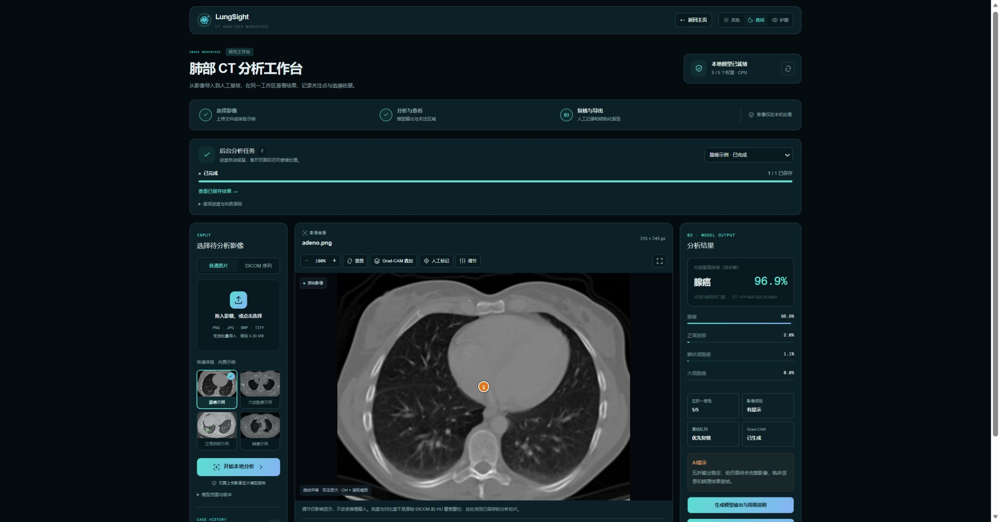

# LungSight 肺影智析

[在线展示](https://wxy11117.github.io/LungSight/) · [下载 Windows 公共测试版](https://github.com/wxy11117/LungSight/releases/tag/v0.1.0-beta.3)

LungSight 是面向肺部 CT 四分类研究的本地智能辅助分析原型，包含影像任务、五折模型推理、质控提示、医生复核、循证医学问答和结构化报告工作流。当前版本仅供科研、教学与产品验证，不是医疗器械，不能替代医生诊断、病理检查或治疗决策。

为避免把大文件写入 Git 历史，本仓库不直接保存模型权重与 Windows 安装包。公共测试安装包通过 GitHub Release 分发，已内置通过清单校验的五折模型；从源码启动前需按模型清单自行准备对应权重。任何本地账号、病例影像、问答记录、API Key、数据库和日志均不属于公开仓库内容。

当前版本已经把网页中的模拟结果替换为真实的本地五折 ResNet18 研究推理，并完成任务留痕、复核和报告下载闭环。技术架构沿用最初方案，但运行权重是审计后重新训练的 `research-fivefold-20260902-165455`，不是最初程序包权重。支持内置二维 CT 示例，也支持上传 PNG、JPG、BMP、TIFF 图片或基础单帧 CT DICOM 序列。

当前公共测试版为 **v0.1.0-beta.3**。新版包含可恢复的后台分析队列、影像缩放与人工标记、三种外观和未保存草稿保护。变更与验收范围见 [发布说明](documentation/RELEASE_v0.1.0-beta.3.md) 和 [工作台验收记录](documentation/UI_POLISH_2026-11-17.md)。



官网用于展示与下载；真实模型分析在本地桌面端执行。

## 启动

在 PowerShell 中进入本目录后运行：

```powershell
.\start-local.ps1
```

登录后统一工作台为 `http://127.0.0.1:3000/agent`，受保护的CT分析界面为
`http://127.0.0.1:3000/analysis`，医生复核与报告中心为 `http://127.0.0.1:3000/review`，
肺癌科研资料库为 `http://127.0.0.1:3000/library`，Agent 评测台为
`http://127.0.0.1:3000/evaluation`，本地接口地址为 `http://127.0.0.1:8001`。

CT分析完成后可从结果页或复核台携带任务编号进入Agent工作台；系统自动关联该次CT结构化结果，
并预填“模型输出、可靠性、局限性和复核重点”的解释问题。医生确认发送后，回答仍执行脱敏、
风险检查、知识库检索和引用核验，不会把语言模型当作影像分类器。

首次进入 `/agent`、`/review` 或 `/evaluation` 时会跳转到 `/auth`。注册产品账号后，
后端通过HttpOnly会话Cookie验证访问权限；每次关闭浏览器或桌面客户端后需要重新登录。
Agent设置页支持按用户加密保存、掩码显示、删除和连接测试 ChatGPT、Kimi 或 DeepSeek API Key。

## 当前边界

### 工作区外观

在Agent账户菜单选择明暗模式和配色后，CT分析、复核报告、资料库与评测页面共用同一外观。
设置保存在当前浏览器，兼容原有 `lungsight.workspace-appearance.v1` 偏好；页面首次渲染前恢复主题，
同一浏览器的其他已打开工作页面也会同步变化。CT原图、Grad-CAM和影像查看底板不参与主题换色。

共享状态：`app/appearance-provider.tsx`；全局配色：`app/workspace-theme.css`。
使用Node 24运行 `node --test tests/appearance.test.mjs`，检查12种配色组合、初始恢复和存储异常等情况。

### 功能与安全范围

- 五个研究模型权重会在服务启动时进行 SHA-256 完整性校验。
- 影像只在本机进入模型，不上传云端。
- 产品账号、任务和大模型配置按用户隔离，未登录不能调用工作区接口。
- 服务商 API Key在后端加密保存，前端不会读取已保存的明文Key。
- 返回四类闭集内部排序、五折一致性、可靠性提示和等待复核状态；类别名称不是病理诊断或患癌概率。
- 使用 SQLite 保存任务、模型版本、概率、可靠性和医生意见，刷新页面后仍可查询。
- 医生可以确认结果、修正分类或标记无法判断；完成后会锁定该次复核记录。
- 支持按状态、预测类别和可靠性筛选，并下载可打印的结构化 HTML 报告。
- 支持批量二维图片与后台任务队列，逐项显示进度；支持取消后继续、部分失败保留成功项与重启恢复。
- 影像质控 Agent 检查尺寸、亮度、对比度、清晰度和重复性。
- 每张新任务生成五折平均 Grad-CAM 注意力图，并在复核台与报告中展示。
- 根据质控、概率和五折一致性自动分配普通、优先或高风险人工检查队列。
- 审计时间线记录 Agent 分析和医生复核事件。
- 本地循证 Agent 已收录肺部 CT 研究材料、论文、模型程序和项目技术文档。
- 循证问答返回来源、版本、页码或压缩包内路径以及 SHA-256 文件指纹。
- 证据不足时明确拒答；患者级诊断、分期、处方和治疗方案不会生成。
- 可将选定循证问答自动加入结构化病例报告与审计时间线。
- 内置 38 项 Agent 回归评测，覆盖模型事实、数据治理、验证边界、项目技术、无证据问题和医疗安全拒答。
- 每次评测独立计算状态、内容、引用、安全和未知问题拒答指标并保存在 SQLite；评测查询不会写入病例记录。
- 基础 DICOM 导入仅支持单帧 CT 对象：本机按空间位置排序、转换固定肺窗，最多等距抽取 32 层进入模型。
- 图片序列与 DICOM 的病例级聚合尚未验证，系统强制阻断病例级候选，只显示内部工程排序。
- 单图研究门槛、模型溯源、输入契约和五项晋级门控写入模型清单，缺失安全字段时后端拒绝加载。
- 原始 DICOM 和身份字段值不落库；烧录文字会被拦截或提示，像素隐私必须人工复核。
- 输出只用于研究流程与工程观察，不构成癌细胞形态识别、病例级组织学候选或临床诊断。

模型适用范围和晋级条件见 `documentation/MODEL_CARD_RESEARCH_2026-09-03.md` 与 `documentation/MODEL_PROMOTION_GATES.md`。

Python 环境重建方法见 `backend/README.md`。
